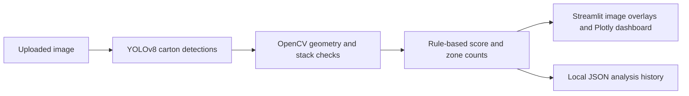

# Carton Compliance Analyzer

A computer vision application that turns warehouse photographs into **carton counts, stacking checks and an interactive analysis dashboard**. Built with YOLOv8, OpenCV and Streamlit.

**Recognition:** Best Innovative Project at university, developed as a two-person project in an event with approximately 300 participants.

## See the application


[Watch the recorded demo](demo.mp4) · [Technical report](docs/RapportTechnique.pdf) · [Main application](app.py)

The recording demonstrates the interface; it is not a link to a hosted service.

## What it does

- Detects cartons using the included `weights/best.pt` checkpoint.
- Checks pairwise overhang, stack height and alignment using configurable geometric rules.
- Counts cartons in user-defined rectangular zones.
- Displays annotated images, detection details and a rule-based compliance score.
- Tracks analysis history and processing times with Pandas and Plotly.
- Saves settings and analysis history to local JSON files.

Here, **compliance** means the application's configured stacking and counting rules. It is not a certified safety or regulatory assessment.

## Processing flow



## Run locally

Use a Python virtual environment and install [requirements.txt](requirements.txt). Large model dependencies may take time to install.

```bash
git clone https://github.com/shirahex/warehouse-management-app.git
cd warehouse-management-app
python -m venv .venv
# macOS/Linux
source .venv/bin/activate
# Windows PowerShell: .venv\Scripts\Activate.ps1
python -m pip install -r requirements.txt
streamlit run app.py
```

Open http://localhost:8501. The YOLO checkpoint is already included; `packages.txt` lists deployment-specific system dependencies.

## Try a review

1. Upload a clear photograph containing cartons.
2. Set detection confidence and overlap thresholds.
3. Configure expected carton count, maximum stack height and overhang limits.
4. Inspect image overlays and the detection, stack and zone results.
5. Open the dashboard to compare saved analyses.

Detection quality depends on image conditions and the checkpoint's training distribution. Verify the detections before interpreting the resulting score.

## Repository map

| Path | Contents |
| --- | --- |
| [app.py](app.py) | Detection, geometric analysis, UI and dashboard |
| [weights/](weights/) | Included YOLO checkpoint |
| [data/](data/) | JSON settings and analysis history |
| [docs/RapportTechnique.pdf](docs/RapportTechnique.pdf) | Technical report |
| [demo.mp4](demo.mp4) | Recorded walkthrough |

## Scope and next steps

The current application analyzes uploaded images, not a live camera stream. Its geometry is based on 2D image coordinates; perspective and occlusion can affect results. A score is a configurable heuristic, not a measured probability of safety. This repository does not publish a reproducible held-out detection benchmark.

Future work includes perspective calibration, labeled evaluation images and repeatable tests for the geometric checks. Local JSON storage is appropriate for a demo; concurrent multi-user use would require persistent storage and access controls.

## Credits and license

Developed by Marouane Daouki with Imane Alouani. Built with Ultralytics, OpenCV, Streamlit and Plotly. See [LICENSE](LICENSE) for the repository's existing GPLv3 notice and [CONTRIBUTING.md](CONTRIBUTING.md) for contribution guidance.


---

Original repository: [shirahex/warehouse-management-app](https://github.com/shirahex/warehouse-management-app). Academic team project by Marouane Daouki and Imane Alouani.
